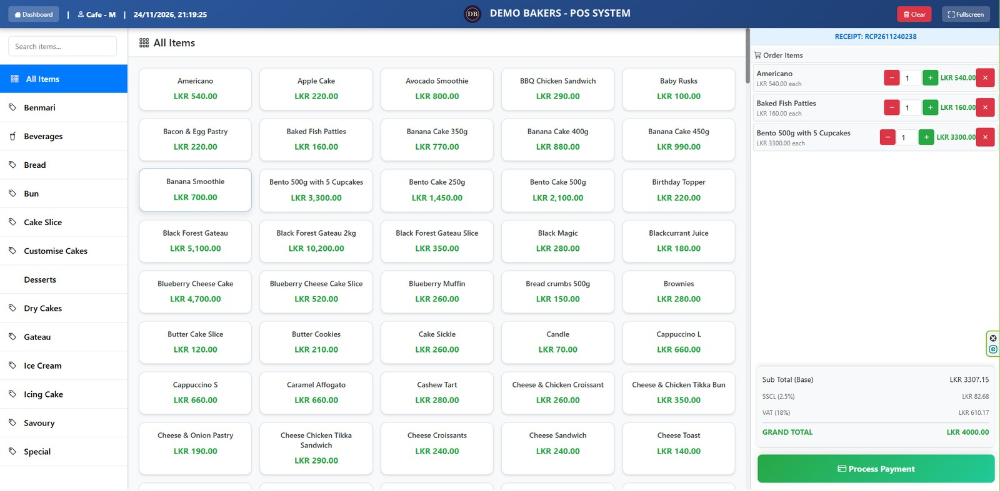
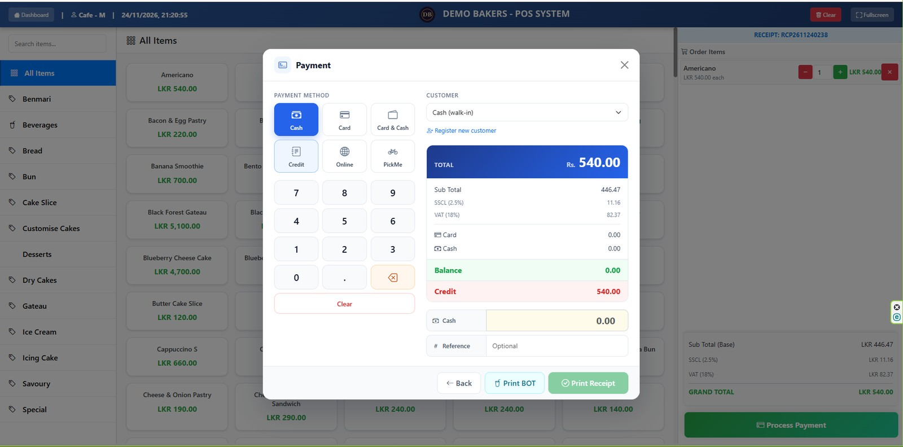
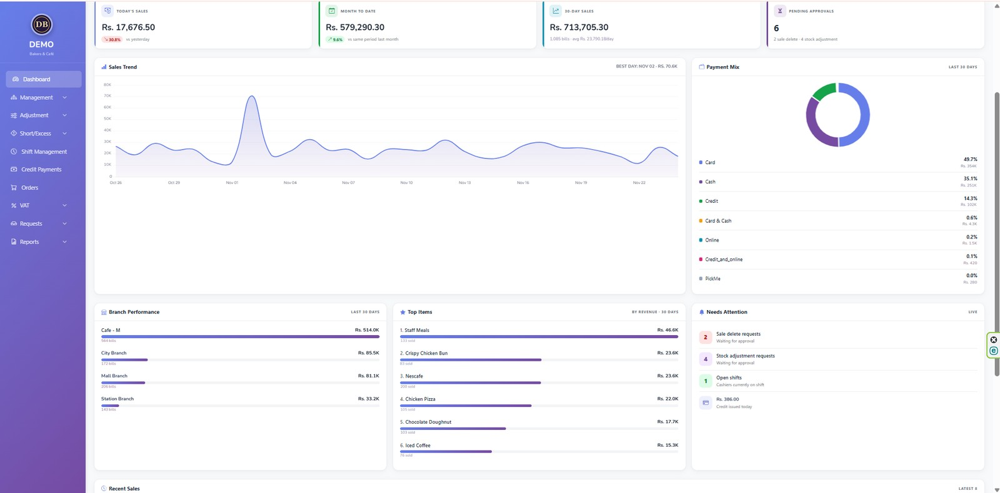

# ☕ Revon Café POS: Multi-Branch Point of Sale System

A complete, touch-friendly **point of sale and back-office system** for a bakery and café chain. Cashiers take orders and payments quickly at the counter, while owners track sales, branches, shifts and approvals from a live admin dashboard.

> 🔒 **This is a client project, so the source code is private.**
> This repository showcases the system's features and screenshots, taken from a demo setup.
> I'm happy to walk through the system and the code in an interview.

---

## 📸 Preview

---

## ✨ Features

### 🛒 POS Screen (Cashier)
- Items grouped by **category** (Beverages, Bread, Cake Slice, Gateau, Savoury and more) with quick **search**
- Tap an item to add it, and change quantities with **+ / −** buttons
- Automatic **SSCL (2.5%)** and **VAT (18%)** calculation with a live grand total
- Unique receipt number for every bill
- **Fullscreen mode** for counter touch screens, with the branch, cashier and live clock in the header

### 💳 Payments
- Six payment methods: **Cash, Card, Card & Cash, Credit, Online and PickMe**
- Built-in **on-screen number pad** for touch screens
- Automatic balance and credit calculation
- Pick a saved customer or **register a new customer** at the counter
- Optional payment reference
- Print the **BOT** (order ticket for the kitchen or bar) and the **customer receipt**

### 📊 Admin Dashboard
- **Today's sales**, **month to date** and **30-day sales**, compared with previous periods
- **Sales trend** chart with the best day highlighted
- **Payment mix** breakdown by payment method
- **Branch performance** across all branches
- **Top items** by revenue
- **Needs attention** panel: pending approvals, open shifts and credit issued today

### 🏢 Back Office
- **Multi-branch** support
- **Approval workflow**: sale deletions and stock adjustments must be approved by a manager
- **Shift management** for cashiers
- **Short / excess** tracking
- **Credit payments** from customers
- Orders, VAT and detailed **reports**

---

## 🛠 Tech Stack

| Layer | Technology |
|---|---|
| Backend | Laravel (PHP) |
| Frontend | Blade templates, JavaScript |
| Database | MySQL |

---

## 🖼 Screenshots

### POS Screen

### Payment

### Admin Dashboard

> Screenshots are taken from a demo setup ("Demo Bakers") with demo data.

---

## 🎥 Demo Video

<!-- Drag your MP4 into the GitHub editor here, or paste an unlisted YouTube link -->
_Coming soon_

---

## 👨‍💻 Developer

**Tharaka Gunasinghe**, Full-stack Developer
[GitHub](https://github.com/Tharaka901) · [LinkedIn](https://linkedin.com/in/YOUR-LINKEDIN) · [Email](mailto:tharakamihiri@gmail.com)
